# Experiment 5: Security, version control, CI/CD and cloud deployment

Web Technology Laboratory (23CSB40B), Module 5 (CO5)

## Aim

To secure the MERN application against common OWASP vulnerabilities, manage it with Git/GitHub, configure a CI pipeline, deploy it to the cloud, and analyse and improve its performance.

## Question

Prepare the TechFest 2026 Portal for production deployment by implementing security, version control, performance optimisation and cloud deployment.

1. Identify potential security vulnerabilities in the application and implement appropriate preventive measures.
2. Secure user authentication and sensitive information during communication between the client and the server.
3. Maintain the project using Git by demonstrating appropriate branching and merging strategies.
4. Configure an automated deployment pipeline for the application.
5. Deploy the frontend, backend and database using suitable cloud platforms.
6. Optimise the application to improve loading speed and overall performance.
7. Analyse the deployed application using browser developer tools and performance auditing tools, and document the observations.
8. Verify that the deployed application functions correctly across different devices and browsers.
9. Prepare a brief deployment report including the application architecture, deployment URLs and screenshots of the deployed application.

## The application

The TechFest 2026 Portal lets students browse fest events, register for them, see a day-wise schedule, look at the gallery and leave feedback. The frontend is React 18 built with Vite, with React Router for pages. The backend is Express 4 with Mongoose, and login uses a JWT stored in a cookie. MongoDB stores three collections: users, events and feedbacks.

| Part     | Technology                      | Hosted on      |
| -------- | ------------------------------- | -------------- |
| Frontend | React 18, Vite 6, React Router  | Netlify        |
| Backend  | Node 22, Express 4, Mongoose 8  | Render         |
| Database | MongoDB 7                       | MongoDB Atlas  |
| CI       | GitHub Actions, Jest, Supertest | GitHub         |

## Architecture

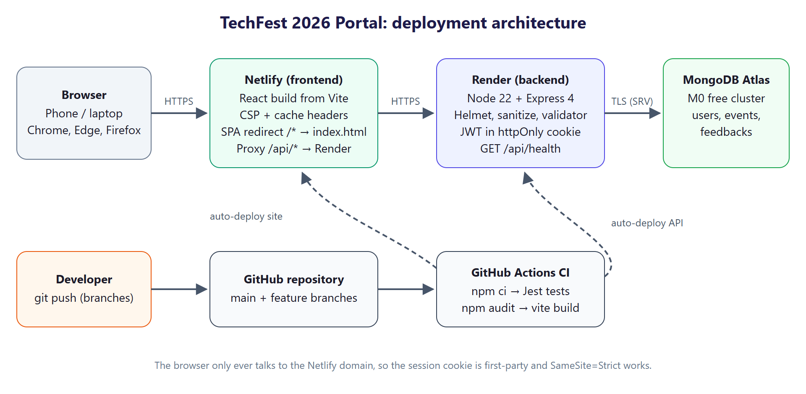

The browser only talks to the Netlify domain. Netlify serves the built React files and forwards every `/api/*` request to the Express API on Render (a proxy rule in `netlify.toml`). The API reads and writes MongoDB Atlas over TLS. Because the API is reached through the same domain as the site, the login cookie is a first-party cookie, so it can use `SameSite=Strict` without breaking login.

## 1. Security vulnerabilities and fixes

To try the attacks safely, I kept a separate, deliberately vulnerable copy of the login and feedback code in `server/security-demo/vulnerable-server.js` (run with `npm run demo:vulnerable`, port 4001, own in-memory database). The real app was then fixed and the same attacks were repeated against it. All screenshots are in `docs/screenshots/`.

### 1.1 NoSQL injection (login bypass)

The vulnerable login passes `req.body` straight into the query:

```js
User.findOne({ email: req.body.email, password: req.body.password });
```

Sending a Mongo operator instead of a password, `{"email": "admin@techfest.in", "password": {"$ne": null}}`, turns the condition into "password is not null", which every user matches. The server answered `200 Welcome Fest Admin!` and set a session cookie without the password ever being known.

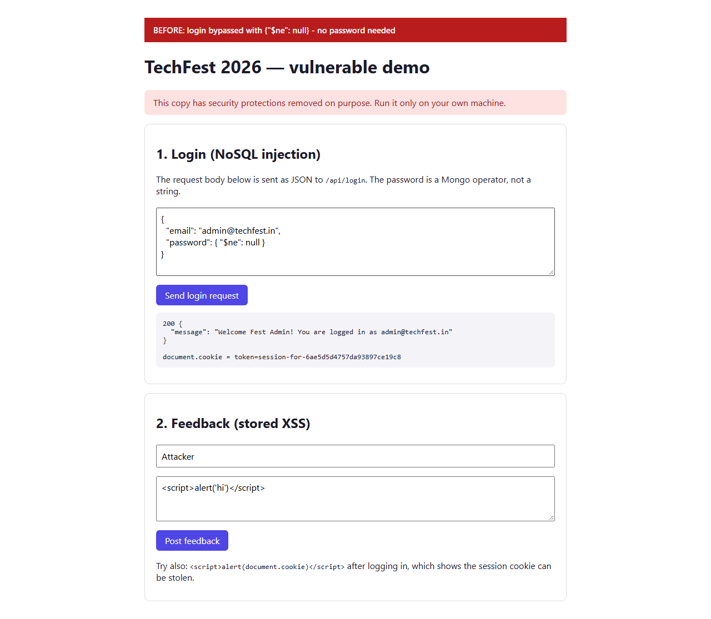

Fixes in the real app:

- `express-mongo-sanitize` removes any key that starts with `$` or contains `.` from `req.body`, `req.query` and `req.params`.
- `express-validator` checks that `email` and `password` are strings (and that the email is valid) before the route runs. An object like `{"$ne": null}` fails with `400 Password is required`.
- Passwords are hashed with bcrypt and compared in code, never inside the query.

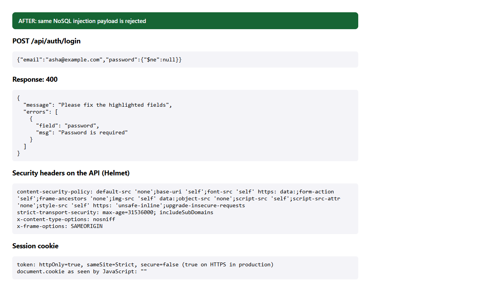

### 1.2 Cross-site scripting (stored XSS)

In the vulnerable copy, feedback text is glued into the HTML page as it is. Posting `<script>alert('hi')</script>` stores the script, and it runs for everyone who opens the page; the alert popped up on page load. The first version of the React app had the same problem in another form, because it used `dangerouslySetInnerHTML` to show feedback.

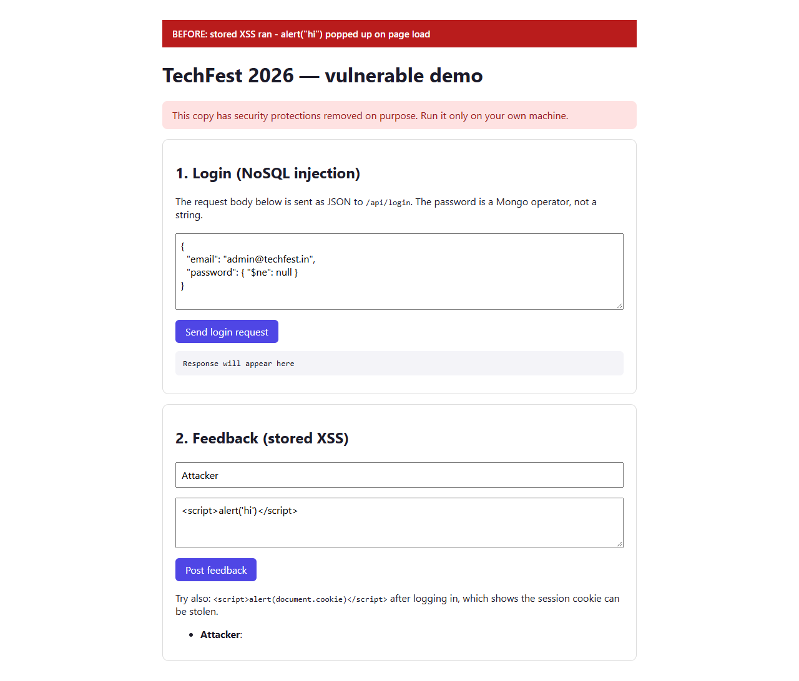

Fixes:

- Feedback is now rendered as `{f.message}`. React escapes it, so the payload shows on screen as plain text.
- Helmet sets a Content-Security-Policy on the API, and `netlify.toml` sets one for the site: `script-src 'self'`, no inline scripts. Even if some HTML slipped through, an injected inline script or `onerror=` handler would be blocked by the browser.
- Feedback length is limited to 500 characters and the API only returns JSON.

Both `<script>alert('hi')</script>` and `` were posted through the real form. Neither ran; both appear as text.

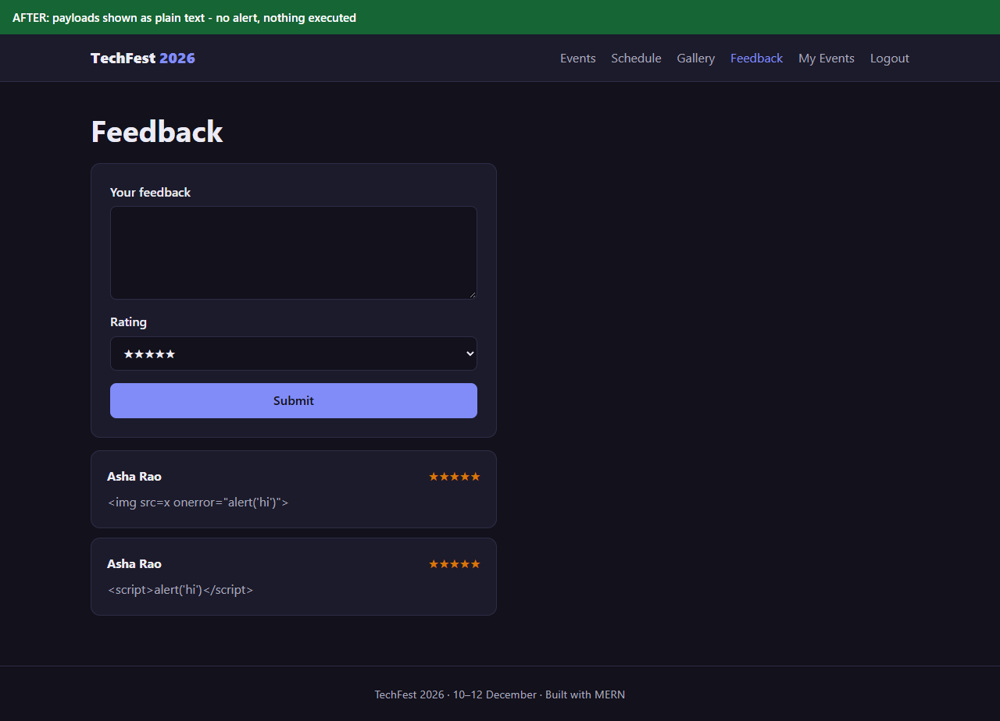

### 1.3 Other measures

| Risk (OWASP 2021)                    | Measure in the code                                                                 |
| ------------------------------------ | ----------------------------------------------------------------------------------- |
| A01 Broken access control            | `requireAuth` middleware on registration, feedback and "my events" routes           |
| A02 Cryptographic failures           | bcrypt (10 rounds), HTTPS only, HSTS header, secrets kept in environment variables  |
| A03 Injection                        | mongo-sanitize, express-validator, `isMongoId()` on route ids                       |
| A04 Insecure design                  | Origin check against cross-site requests, capacity check on events                  |
| A05 Security misconfiguration        | Helmet headers, `X-Powered-By` removed, generic 500 messages, 10 kB body limit      |
| A07 Identification and auth failures | Rate limit of 30 attempts per 15 minutes on `/api/auth`, 8+ character passwords with a letter and a number |
| A06 Vulnerable components            | `npm audit --omit=dev` runs in CI and fails on high-severity issues                 |

## 2. Securing authentication and communication

After login the server signs a JWT (`{ id }`, valid for 2 hours) and sends it as a cookie with these options:

```js
res.cookie('token', token, {
  httpOnly: true,                                  // JavaScript cannot read it
  secure: process.env.NODE_ENV === 'production',   // only sent over HTTPS
  sameSite: 'strict',                              // not sent on requests started by other sites
  maxAge: 2 * 60 * 60 * 1000,
});
```

In the vulnerable copy the cookie had no options, and the demo page could print it with `document.cookie`, so an XSS payload could steal the session. In the fixed app `document.cookie` returns an empty string, and Chrome DevTools (Application tab, Cookies) shows the token with HttpOnly ticked and SameSite set to Strict.

CSRF (cross-site request forgery) is when a page on another site makes the user's browser send a request to our API, for example a hidden form that posts feedback or registers for an event. The browser would normally attach the user's cookie automatically, so the request looks genuine. With `SameSite=Strict` the browser does not attach the cookie to any request started from another site, so the forged request arrives logged out and gets a 401. As a second check, the API rejects any POST whose `Origin` header is not our own frontend (`403 Cross-site request blocked`), and CORS only allows that origin.

All traffic is HTTPS: Netlify and Render both issue certificates automatically, the API redirects plain HTTP to HTTPS in production (`308`), and HSTS tells the browser to use HTTPS for a year. The Atlas connection string uses `mongodb+srv://`, which is TLS by default.

## 3. Version control with Git

The project was put under Git with `git init`. `.gitignore` lists `node_modules`, `.env`, `dist` and logs, so dependencies and secrets are never committed; only `server/.env.example` (with no real values) is in the repository.

Work was done on short-lived branches and merged into `main` with `git merge --no-ff`, so each feature shows as its own loop in the graph:

- `feature-security` holds all the security fixes.
- `feature-page` adds the Schedule page.
- `update-tagline` was used for the deliberate merge conflict.
- `perf-optimizations` holds the lazy loading and Lighthouse fixes.

```
* 1f095b9 deploy: point /api proxy at the live Render service
* 80eedd8 docs: Experiment 5 report, architecture diagram, screenshots, deployment steps
* f25ca6e deploy: Render blueprint, Netlify config with /api proxy, CSP and cache headers
*   8fe609c Merge branch 'perf-optimizations'
|\
| * 7ec85e3 perf: lazy-load pages and gallery images, gzip API, Lighthouse fixes
|/
*   eca65f9 Merge branch 'update-tagline' (resolve tagline conflict)
|\
| * 4095526 update hero tagline
* | 78f7034 reword hero tagline
|/
*   957465e Merge branch 'feature-page'
|\
| * 9e6fdf4 add Schedule page grouped by day
|/
* b16e343 fix: event count test should use the seed data length
* c8e6bec test: check total event count
* dfd1b3b add Jest + Supertest tests and GitHub Actions CI pipeline
*   60c92de Merge branch 'feature-security'
|\
| * 1499ea4 security: helmet, mongo-sanitize, input validation, secure cookies, XSS-safe feedback
|/
* 64eccdd add vulnerable copy for security demos (NoSQL injection, stored XSS)
* c7a53b3 first version: TechFest portal API and React client
```

### Merge conflict

On `update-tagline` the hero tagline in `client/src/pages/Home.jsx` was changed to "Code. Build. Compete. ...", and on `main` the same line was changed to "Three days of hackathons, robots and live music." Running `git merge update-tagline` stopped with `CONFLICT (content): Merge conflict in client/src/pages/Home.jsx` and marked the file:

```
<<<<<<< HEAD
        <p className="tagline">Three days of hackathons, robots and live music.</p>
=======
        <p className="tagline">Code. Build. Compete. The biggest student tech fest in Kerala.</p>
>>>>>>> update-tagline
```

I kept the slogan from one side and the description from the other, deleted the three marker lines, then ran `git add` and `git commit`. That is commit `eca65f9`, which has two parents in the graph above.

## 4. CI/CD pipeline

`.github/workflows/ci.yml` runs on every push to any branch and on pull requests to `main`. It has three jobs:

1. API tests: `npm ci`, `npm test` (19 Jest + Supertest tests against an in-memory MongoDB), then `npm audit --omit=dev --audit-level=high`.
2. React build: `npm ci`, `npm run build`, and the `dist` folder is uploaded as a build artifact.
3. Deploy (only on `main`, only if both jobs pass): calls a Render deploy hook if the `RENDER_DEPLOY_HOOK` secret is set. Netlify and Render also auto-deploy from GitHub on their own.

The tests cover registration, password hashing, login, the cookie flags, the three NoSQL injection payloads, XSS payload storage, the CSRF origin check, the Helmet headers, the body size limit, event registration and validation.

To show a failing pipeline, commit `c8e6bec` changed one test to expect 7 events when the seed data has 6. That commit was pushed to GitHub on its own first. Run #1 failed at the "Run tests" step of the API job (the React build job still passed, and the deploy job was skipped). Commit `b16e343` put the expectation back (`events.length`). The rest of `main` was then pushed, and run #2 on `80eedd8` passed every job. The four feature branches were pushed too, and their runs are green as well.

Repository: https://github.com/ParthivKiranNayar/techfest-2026-portal

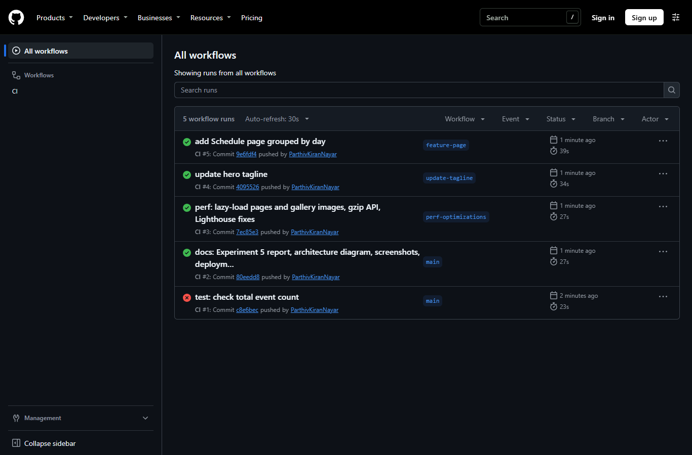
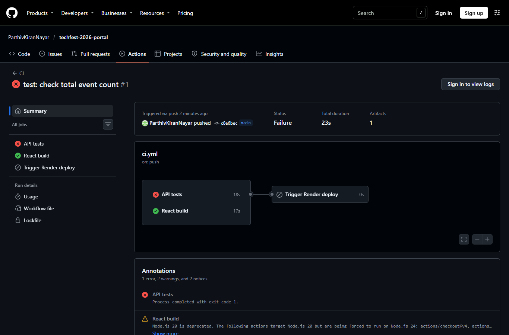
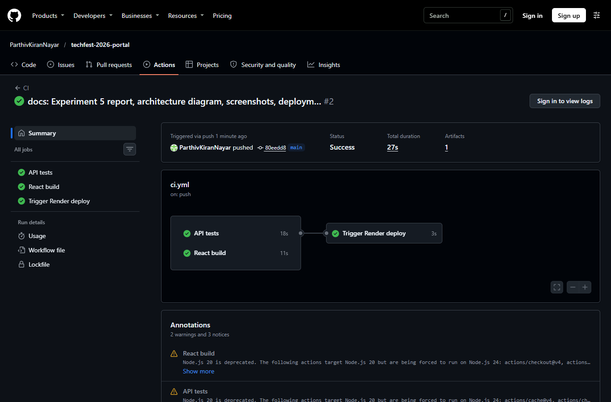
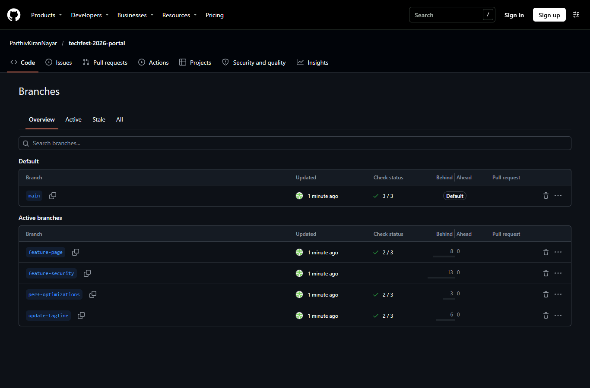

## 5. Cloud deployment

| Tier     | Platform      | URL                                                    |
| -------- | ------------- | ------------------------------------------------------ |
| Frontend | Netlify       | https://cerulean-moxie-b8cfc3.netlify.app              |
| Backend  | Render        | https://techfest-api-i47k.onrender.com (try `/api/health`) |
| Database | MongoDB Atlas | `cluster0.bttdluo.mongodb.net`, database `techfest`    |
| Code     | GitHub        | https://github.com/ParthivKiranNayar/techfest-2026-portal |

Database: the existing M0 free cluster on MongoDB Atlas was reused (Atlas allows one free cluster per project), with a new database `techfest` in it. A separate database user, `techfest-app`, was created for the app, and network access is open to `0.0.0.0/0` because Render's free tier has no fixed outgoing IP. The connection string went into Render's environment settings as `MONGO_URI`, never into the code. On the first start, the API seeded the six events into the `events` collection.

Backend: a Render Web Service from the GitHub repo, with root directory `server`, build command `npm ci --omit=dev`, start command `npm start` and health check `/api/health`. The environment variables are `NODE_ENV=production`, `MONGO_URI`, `JWT_SECRET` (generated by Render), `CLIENT_ORIGIN` (the Netlify URL) and `TRUST_PROXY=2`. All of this is also in `render.yaml`.

Frontend: a Netlify site from the same repo. `netlify.toml` sets the base directory to `client`, runs `npm run build` and publishes `dist`. It also has two redirect rules: `/api/*` is proxied to the Render URL, and `/*` falls back to `index.html` so that refreshing `/events` or `/dashboard` does not give a 404.

The first attempt to register on the live site failed with `403 Cross-site request blocked`. That was the Origin check from section 2 working: Render did not yet know the Netlify address. After setting `CLIENT_ORIGIN=https://cerulean-moxie-b8cfc3.netlify.app` and redeploying, registration worked.

Checks on the live site (1 November 2026):

- `GET /api/health` through the Netlify proxy returns `{"status":"ok"}`.
- Registering a new account returns `201`, with the cookie `token=...; HttpOnly; Secure; SameSite=Strict`. Joining an event, the dashboard and feedback all work, and refreshing `/events` or `/dashboard` loads the page instead of a 404.
- The new users appear in Atlas under Browse Collections → `techfest` → `users`, and the `password` field holds a bcrypt hash (`$2a$10$...`), not the password. The `techfest` database has the `users`, `events` (6) and `feedbacks` collections.
- The attacks were repeated on the live site. `{"$ne": null}` as the password gets `400`, a POST with `Origin: https://evil.example` gets `403`, and `<script>alert('hi')</script>` posted as feedback shows as text without an alert.
- Both hosts use TLS 1.3. The Netlify certificate is for `*.netlify.app` (DigiCert); the Render certificate is for `onrender.com`. Plain `http://` gets a 301 to `https://` on both, and both send an HSTS header.

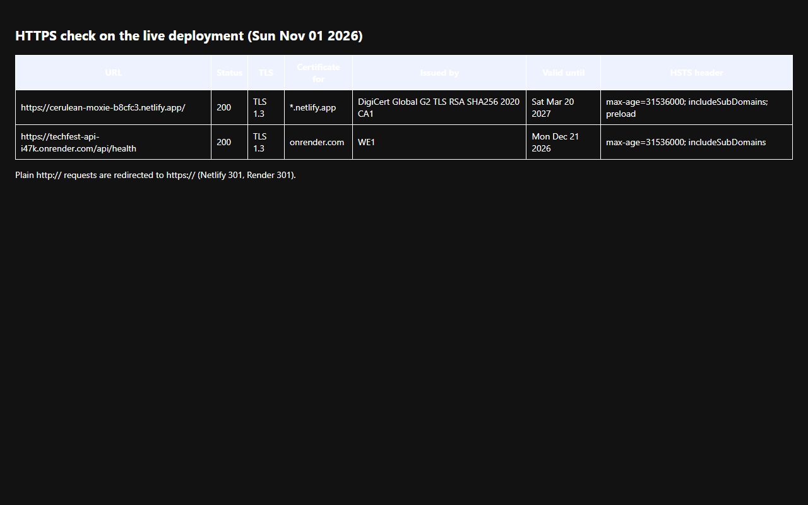

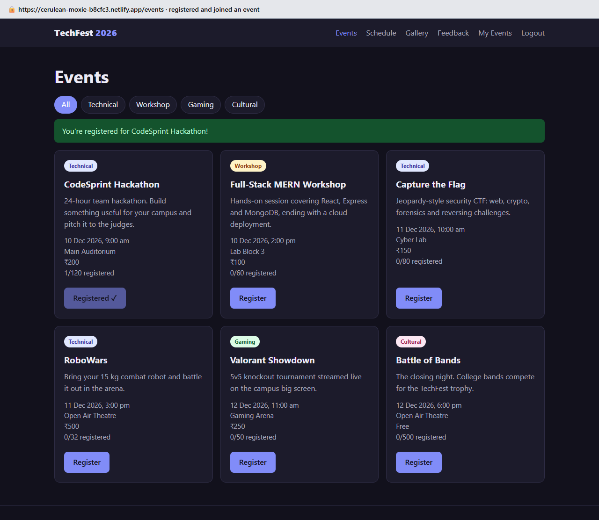
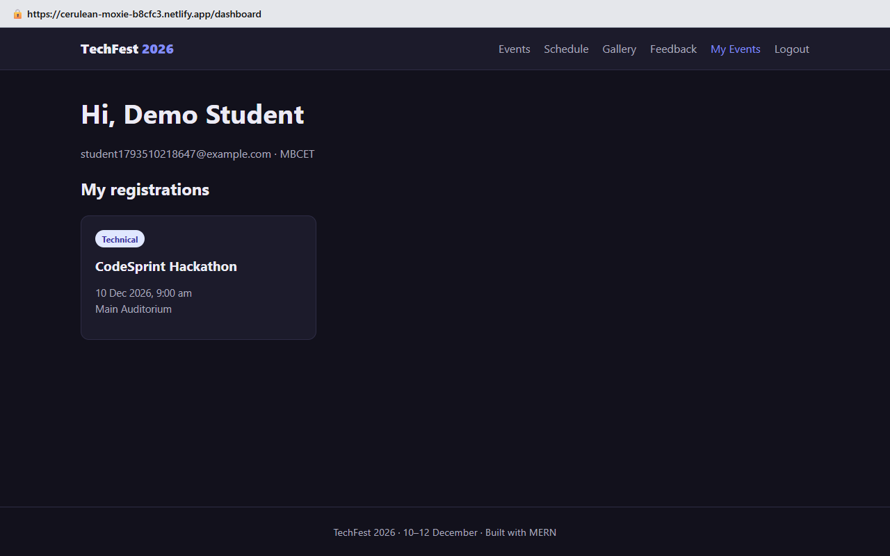
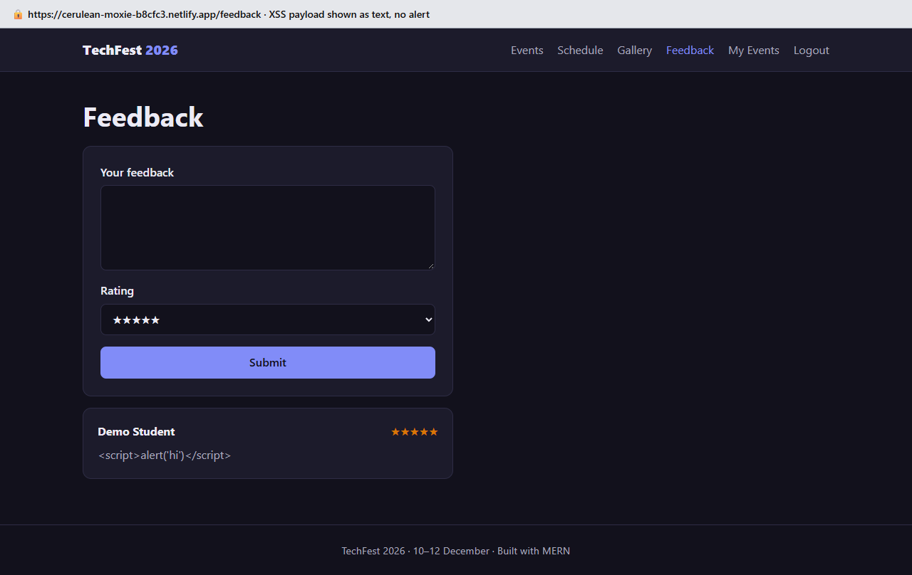

One thing to know about the free tier: Render puts the API to sleep after 15 minutes without traffic. The first request after that can take up to about a minute while it wakes up, and later requests are fast.

## 6. Performance optimisation

Changes made on the `perf-optimizations` branch:

- Every page except Home is loaded with `React.lazy()` and `Suspense`, so its code is downloaded only when someone opens that page.
- React, ReactDOM and React Router go into a separate `vendor` chunk. App changes do not change its file name, so returning visitors keep it in cache.
- Gallery images have `width`/`height` (no layout shift), `loading="lazy"` for images below the first row, and `fetchpriority="high"` on the first one.
- The API gzips responses with `compression()`.
- Netlify serves `/assets/*` with `Cache-Control: max-age=31536000, immutable`. Vite puts a content hash in every file name, so this is safe.

Build output from `npm run build`:

| Build  | JS loaded on first visit                        | Gzipped |
| ------ | ----------------------------------------------- | ------- |
| Before | `index.js` 179.13 kB (one file, all pages)       | 58.04 kB |
| After  | `index.js` 8.12 kB + `vendor.js` 164.76 kB       | 57.23 kB |

Each page chunk after the split is between 0.34 kB (NotFound) and 2.10 kB (Events). The first-visit saving is small (about 6 kB), because most of the size is React itself. The bigger gain is caching: after an update, a returning visitor downloads about 8 kB of changed app code and keeps the 165 kB vendor file.

## 7. Analysis with DevTools and Lighthouse

Lighthouse 12 was run in mobile mode on the production build (`vite preview` on localhost) before and after the fixes. The site was deployed only after the fixes, so the live site has one set of numbers, shown further down. The full HTML reports are in `docs/lighthouse/`.

| Page    | Run    | Performance | Accessibility | Best practices | SEO |
| ------- | ------ | ----------- | ------------- | -------------- | --- |
| Home    | Before | 100 | 94  | 96  | 82  |
| Home    | After  | 100 | 100 | 100 | 100 |
| Gallery | Before | 100 | 86  | 96  | 75  |
| Gallery | After  | 99  | 100 | 100 | 100 |

What Lighthouse flagged, and what was done about it:

1. `image-alt`: gallery images had no `alt`. Each image now has a description.
2. `html-has-lang`: the `<html>` tag had no `lang`. Added `lang="en"`.
3. `meta-description`: there was none. Added one, plus `theme-color`.
4. `robots-txt`: `/robots.txt` returned the React page, which is not a valid robots file. Added a real `robots.txt` that disallows `/dashboard`.
5. `errors-in-console`: every logged-out page load logged a 401 from `/api/auth/me`. Added `/api/auth/session`, which answers 200 with `user: null`.
6. `unused-javascript`: fixed by code splitting (section 6).

After the first round, the Gallery page showed a new layout shift (CLS 0.086). The short "Loading..." text shown while the page chunk downloads let the footer jump up, and then down again. Giving the loading placeholder a full-screen minimum height brought CLS back to 0. Gallery Performance is 99 and not 100 because the first image is only found after the Gallery chunk loads, which is the cost of lazy loading that page.

Lighthouse on the deployed site (https://cerulean-moxie-b8cfc3.netlify.app, mobile, 1 November 2026):

| Page    | Performance | Accessibility | Best practices | SEO | FCP   | LCP   | TBT   | CLS |
| ------- | ----------- | ------------- | -------------- | --- | ----- | ----- | ----- | --- |
| Home    | 99 | 100 | 93 | 100 | 1.3 s | 1.5 s | 0 ms  | 0 |
| Gallery | 96 | 100 | 93 | 100 | 1.4 s | 1.5 s | 10 ms | 0 |

Best practices is 93 on the live site and 100 locally, and the reason is interesting. On free sites, Netlify adds its own toolbar script (`/.netlify/scripts/hud`) at the end of every page, and that script tries to inject an inline `<script>` and an inline style. Our CSP (`script-src 'self'; style-src 'self'`) blocks both, and Chrome logs the two violations as console errors, which Lighthouse counts against the site. This is the CSP doing exactly what it is meant to do with code we did not write. I kept the strict policy; allowing inline code just to silence the warning would weaken the XSS protection. Gallery also scores a bit lower here because the gallery images are cached for 7 days, and Lighthouse suggests longer.

DevTools observations:

- Network tab: on Home, only `index.js`, `vendor.js` and the CSS load. Opening Gallery downloads `Gallery-*.js` (1.15 kB) at that moment, and the last images load only when scrolled near.
- Network tab, response headers: the API sends `content-security-policy`, `strict-transport-security`, `x-content-type-options: nosniff` and `x-frame-options`, and has no `x-powered-by`.
- Application tab, Cookies: `token` is HttpOnly, Secure (on the live site) and SameSite Strict.
- Performance tab: total blocking time is 0-10 ms on both pages; the main thread is idle almost all the time.

## 8. Cross-device and cross-browser testing

All checks were done on the live site.

| Device / browser                              | Home | Events + register | Login / logout | Gallery | Feedback | Refresh on /dashboard |
| --------------------------------------------- | ---- | ----------------- | -------------- | ------- | -------- | --------------------- |
| Laptop, Chrome 1280 × 800                     | OK | OK | OK | OK | OK | OK |
| Phone size, Chrome mobile emulation 390 × 844 | OK | OK | OK | OK | OK | OK |
| Laptop, Microsoft Edge 156 1280 × 800         | OK | OK | OK | OK | OK | OK |
| Phone size, Edge mobile emulation 390 × 844   | OK | OK | OK | OK | OK | OK |
| Android phone, Chrome                         |  |  |  |  |  |  |

In Edge, the full flow was run: log in, join an event, post feedback, refresh `/dashboard` (still logged in), log out, then open `/dashboard` again (sent to `/login`). There were no JavaScript errors. On narrow screens, the navigation turns into a menu button that opens a drop-down, the event cards go to one column and the stat boxes go two per row. The site follows the system light or dark theme. Firefox is not installed on this laptop, so it was not tested.

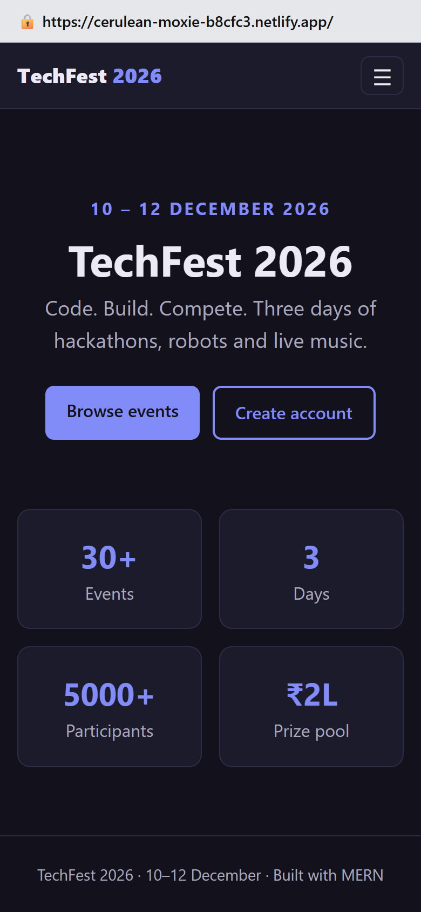
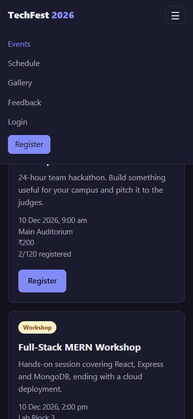
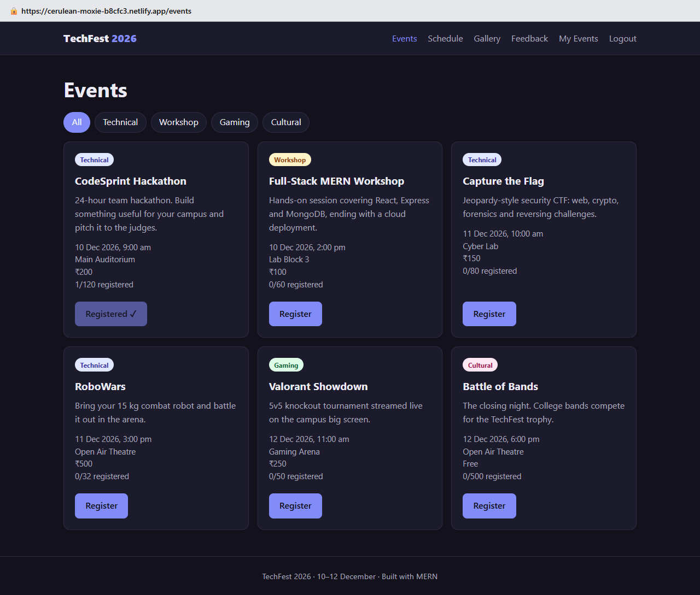
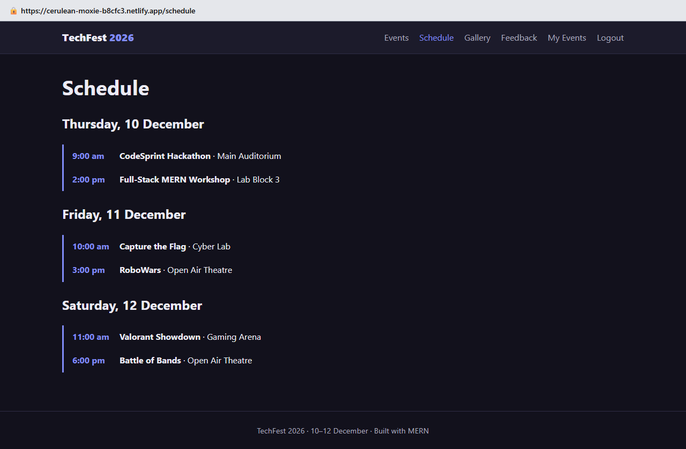
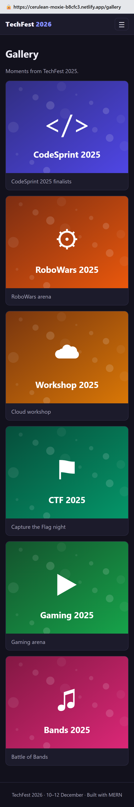

## Result

Thus the Security, Version Control, CI/CD and Cloud Deployment was developed and its output verified successfully.
